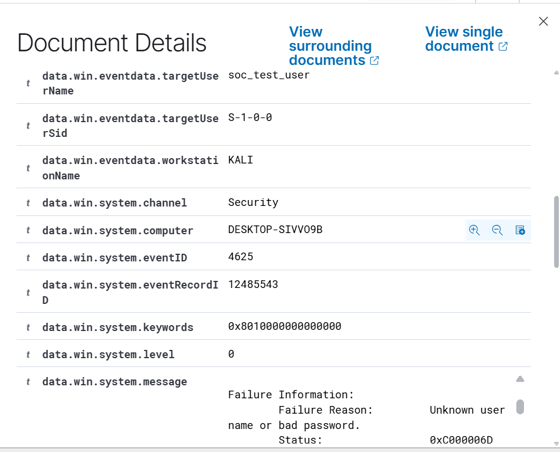

# BAZECORP Enterprise SOAR

### Enterprise-Style Security Orchestration, Automation and Response

**Automated Security Monitoring | Threat Detection | Incident Correlation | MITRE ATT&CK | Telegram Incident Reporting**

[](https://www.microsoft.com/windows)
[](https://learn.microsoft.com/sysinternals/downloads/sysmon)
[](https://wazuh.com/)
[](https://attack.mitre.org/)
[](https://telegram.org/)

---

## 1. Project Overview

BAZECORP Enterprise SOAR is an independently developed, enterprise-style Security Orchestration, Automation and Response project designed to demonstrate how a Security Operations Centre (SOC) can monitor endpoint activity, identify suspicious behaviour, correlate security events, enrich detections with MITRE ATT&CK intelligence and automatically generate incident notifications.

The project uses a controlled virtual lab environment to simulate enterprise security monitoring and attack scenarios.

Its central monitoring workflow uses a Python-based live monitor to process Windows endpoint telemetry and generate structured security alerts. Telegram provides automated incident notifications, while Wazuh supplies additional endpoint telemetry collection, security event analysis and validation.

The system is designed to support security analysts by reducing manual monitoring effort and improving the speed and consistency of incident reporting.

**Core principle: FINAL DECISION LEFT FOR THE ANALYST.**

The platform supports detection and reporting. Investigation, validation and authorization of response actions remain with the analyst.

### Source Code Publication

The repository now includes a dedicated `SOAR-SOURCE-REVIEW/` directory containing the published Python source files, supporting modules, configuration templates, detection logic, MITRE ATT&CK mapping, notification components and supporting documentation.

This source package is provided for technical inspection, learning, transparency and further development. Its inclusion does not mean that every included module has been integrated into or validated as part of the demonstrated live monitoring workflow.

## 2. Project Objectives

- Develop a continuously running endpoint monitoring workflow.
- Monitor Windows Sysmon and Windows Security events.
- Identify suspicious process execution and authentication activity.
- Detect repeated failed authentication attempts.
- Identify selected suspicious PowerShell execution patterns.
- Correlate related security events within configured time windows.
- Enrich supported detections with MITRE ATT&CK techniques.
- Generate structured security incident reports.
- Deliver automated Telegram notifications.
- Demonstrate analyst-led incident investigation and response decisions.

## 3. Enterprise Lab Architecture

### Logical architecture

The project uses a distributed lab architecture consisting of an attacker machine, a monitored Windows endpoint, a central Wazuh server and a Telegram notification channel.

```text
                 CONTROLLED SECURITY LAB
                          |
                          |
                +----------------------+
                |     KALI LINUX       |
                |   Attacker Machine   |
                |   192.168.56.111     |
                +----------+-----------+
                           |
                           | Controlled attack simulations
                           | Nmap / SMB / PowerShell tests
                           |
                           v
                +----------------------+
                |   WINDOWS 11         |
                |   SOC ENDPOINT       |
                |   192.168.56.1       |
                |                      |
                |   Sysmon             |
                |   Windows Security   |
                |   Wazuh Agent        |
                |   Python Live Monitor|
                +----------+-----------+
                           |
                 +---------+----------+
                 |                    |
                 v                    v
        +------------------+   +----------------------+
        | PYTHON SOAR      |   | WAZUH SERVER         |
        | DETECTION ENGINE |   | 192.168.56.122       |
        |                  |   |                      |
        | Event Monitoring |   | Wazuh Manager        |
        | Event Correlation|   | Wazuh Indexer        |
        | MITRE Mapping    |   | Wazuh Dashboard      |
        | Severity Rating  |   | Central Event Review |
        +--------+---------+   +----------------------+
                 |
                 | Structured incident notification
                 v
        +----------------------+
        | TELEGRAM             |
        | SOC NOTIFICATIONS    |
        |                      |
        | Incident Reports     |
        | Severity Levels      |
        | MITRE ATT&CK Details |
        | Analyst Assessment   |
        +----------------------+
```

### Lab components

| Component | Purpose |
|---|---|
| Kali Linux | Controlled attack simulation and security testing |
| Windows 11 | Monitored endpoint and SOC workstation |
| Sysmon | Process and endpoint telemetry collection |
| Windows Security Logs | Authentication and network connection events |
| Python live monitor | Event monitoring, detection and correlation |
| MITRE ATT&CK | Threat technique enrichment |
| Wazuh Agent | Endpoint telemetry forwarding |
| Wazuh Server | Centralised event analysis and dashboard |
| Telegram Bot | Automated incident notification |

### Lab network addressing

| System | Lab IP address |
|---|---|
| Kali Linux | 192.168.56.111 |
| Windows 11 endpoint | 192.168.56.1 |
| Wazuh server | 192.168.56.122 |

These addresses belong exclusively to the controlled lab environment.

## 4. Detection and Monitoring Capabilities

### A. Network reconnaissance

Controlled Nmap scans are performed from Kali Linux against the Windows endpoint.

Activities include:

- TCP port discovery.
- Identification of open and filtered ports.
- Service and version enumeration.
- Identification of exposed services such as SSH, SMB, NetBIOS and RPC.

The project collects Windows network telemetry to support investigation of inbound connections.

### B. Failed authentication and password guessing

Windows Security Event ID 4625 is monitored for failed authentication attempts.

The Python detection workflow correlates repeated failures by source IP within a configured time window.

Demonstrated detection:

- Five failed authentication attempts.
- One source IP.
- One targeted account.
- Five-minute correlation window.
- HIGH severity notification.
- MITRE ATT&CK T1110.001 — Password Guessing.

### C. Suspicious PowerShell execution

Sysmon Event ID 1 is monitored for selected suspicious process execution patterns.

The demonstrated test uses a harmless encoded PowerShell command to validate detection and reporting.

Demonstrated mapping:

- Sysmon Event ID 1.
- Encoded PowerShell command execution.
- HIGH severity notification.
- MITRE ATT&CK T1059.001 — PowerShell.
- Execution tactic.

### D. Network connection monitoring

Windows Security Event ID 5156 is monitored for permitted inbound connections from the designated Kali lab host.

The report includes:

- Source and destination IP addresses.
- Source and destination ports.
- Application and process information where available.
- Protocol.
- Windows Security record identifier.

A permitted connection is not, by itself, proof of malicious activity or successful exploitation. The current evidence shows these individual connection alerts classified as LOW.

## 5. Severity Classification

The project uses four severity levels to communicate the assessed significance of detected activity.

| Severity | Meaning |
|---|---|
| CRITICAL | A configured detection indicates activity requiring immediate analyst attention |
| HIGH | Significant suspicious activity or correlated security events |
| MEDIUM | Suspicious or unusual activity requiring investigation |
| LOW | Informational activity or a connection event without sufficient evidence of an attack |

Severity is determined by configured detection logic and lab policy. It should not be interpreted as proof of compromise.

## 6. MITRE ATT&CK Integration

The project uses the MITRE ATT&CK Enterprise framework to enrich supported detections with adversary behaviour classifications.

| Technique | Name | Demonstrated scenario |
|---|---|---|
| T1110.001 | Password Guessing | Repeated failed authentication |
| T1059.001 | PowerShell | Encoded PowerShell execution simulation |

Network discovery and other techniques may be mapped where sufficient telemetry and correlation evidence are available.

A technique mapping is an analytical classification, not proof that an attacker successfully completed the associated behaviour.

## 7. Automated Telegram Incident Reporting

Detected events are converted into structured SOC incident notifications.

The notification format includes:

1. Incident identification and timestamp.
2. Endpoint intelligence.
3. Detection details.
4. MITRE ATT&CK intelligence, where established.
5. SOC analyst assessment.
6. Final decision and response authorization reminder.

The reporting workflow is designed to provide useful context rather than simply forwarding raw event messages.

**FINAL DECISION LEFT FOR THE ANALYST**

Investigate, validate and authorize any response action.

## 8. Project Evidence

The following evidence is organised according to the project naming convention:

- **K** — Kali attack and testing evidence.
- **W** — Wazuh event and detection evidence.
- **T** — Telegram incident reports.
- Numbered files represent the main sequence.
- Decimal suffixes represent continuation screenshots.

### 8.1 Kali attack evidence

Controlled testing and reconnaissance performed from Kali Linux.

**K1 — Initial TCP port reconnaissance**


**K2 — Service and version enumeration**


**K3 — Controlled SMB password guessing test**


**K4 — Encoded PowerShell execution simulation**


### 8.2 Wazuh evidence

Centralised security event evidence from the monitored Windows endpoint.

**W3 — Kali-originated failed authentication event**



### 8.3 Telegram incident reporting evidence

Automated incident notifications generated by the Python monitoring workflow.

**T1 — Inbound SSH connection**


**T1.1 — SSH connection assessment continuation**


**T2 — Inbound NetBIOS connection, port 139**


**T2.1 — Inbound SMB connection, port 445**


**T2.2 — Inbound MSRPC connection, port 135**


**T3 — HIGH severity password guessing detection**


**T3.1 — MITRE T1110.001 assessment**


**T4 — HIGH severity encoded PowerShell detection**


**T4.1 — MITRE T1059.001 assessment**


### 8.4 Demonstration videos

The following videos provide recorded demonstrations of controlled lab testing and monitoring.

**Video 1 — Encoded PowerShell detection demonstration**

[Watch or download the encoded PowerShell detection demonstration](DEMO%20VIDEOS/01-encoded-powershell-detection-demo.mp4)

Demonstrates harmless encoded PowerShell execution simulation and the resulting security notification.

**Video 2 — Kali SMB authentication test**

[Watch or download the Kali SMB authentication test](DEMO%20VIDEOS/02-kali-smb-authentication-test-demo.mp4)

Demonstrates controlled SMB authentication testing from Kali Linux and associated monitoring activity.

**Video 3 — SMB password guessing monitoring demonstration**

[Watch or download the SMB password guessing monitoring demonstration](DEMO%20VIDEOS/03-smb-password-guessing-monitoring-demo.mp4)

Demonstrates controlled failed SMB authentication attempts and the monitoring workflow.

*Note: These are compressed MP4 files stored in the repository. GitHub may offer them as downloadable files rather than inline playback, depending on its preview support.*

## 9. Repository Structure

The repository contains the original project evidence and documentation alongside a separately published source-review package.

### Main repository structure

```text
bazecorp-enterprise-soar/
│
├── KALI ATTACKS/
│
├── WAZUH/
│
├── TELEGRAM REPORTS/
│
├── DEMO VIDEOS/
│   ├── 01-encoded-powershell-detection-demo.mp4
│   ├── 02-kali-smb-authentication-test-demo.mp4
│   └── 03-smb-password-guessing-monitoring-demo.mp4
│
├── SOAR-SOURCE-REVIEW/
│   ├── attack_runner.py
│   ├── requirements.txt
│   ├── telegram_test.py
│   │
│   └── automation/
│       ├── README.md
│       ├── watcher.py
│       ├── telegram_test.py
│       │
│       ├── attack_framework/
│       │   ├── kali_simulator.py
│       │   ├── lolbin_simulator.py
│       │   ├── powershell_simulator.py
│       │   └── windows_attack.py
│       │
│       ├── config/
│       │   ├── live_sysmon_monitor.py
│       │   └── telegram_config.py
│       │
│       ├── core/
│       │   ├── constants.py
│       │   ├── main.py
│       │   ├── menu.py
│       │   └── version.py
│       │
│       ├── detection/
│       │   ├── __init__.py
│       │   ├── alert_engine.py
│       │   └── parser.py
│       │
│       ├── engines/
│       │   ├── sentinel_engine.py
│       │   ├── splunk_engine.py
│       │   └── wazuh_engine.py
│       │
│       ├── mitre/
│       │   ├── mapping.py
│       │   └── techniques.json
│       │
│       ├── notifications/
│       │   ├── __init__.py
│       │   ├── report_generator.py
│       │   └── telegram_notifier.py
│       │
│       └── utils/
│           ├── banner.py
│           ├── colors.py
│           ├── helpers.py
│           └── logger.py
│
└── README.md
```

The `SOAR-SOURCE-REVIEW` directory is a separately published source package. Its modules are included for inspection and further development; their presence does not imply that every component is active in the demonstrated workflow.

*Note: The original logical project structure and evidence organisation are retained. The source-review tree above reflects the files published in the repository. Do not create empty or placeholder modules simply to match this illustration.*

## 10. Source Code Setup and Installation

The published source code is available under:

`SOAR-SOURCE-REVIEW/`

### Requirements

- Windows 10 or Windows 11 for the Windows endpoint monitoring components.
- Python 3.
- Git, for cloning the repository.
- Required Python packages listed in the included `requirements.txt`.
- A Telegram bot and chat ID if Telegram notifications are to be configured.
- Appropriate Windows event-log permissions for endpoint monitoring.

### Step 1 — Clone the repository

```powershell
git clone https://github.com/DanielNwachukwu/bazecorp-enterprise-soar.git
```

### Step 2 — Enter the source directory

```powershell
cd bazecorp-enterprise-soar
cd SOAR-SOURCE-REVIEW
```

### Step 3 — Create a virtual environment

```powershell
python -m venv venv
```

Activate it:

```powershell
.\venv\Scripts\Activate.ps1
```

If PowerShell blocks activation, use an appropriate execution policy for your environment or activate the environment through another supported method.

### Step 4 — Install dependencies

```powershell
python -m pip install --upgrade pip
pip install -r requirements.txt
```

### Step 5 — Configure Telegram credentials

Open:

`automation/config/telegram_config.py`

The published configuration contains placeholders:

```python
BOT_TOKEN = "INPUT YOUR TELEGRAM BOT TOKEN HERE"
CHAT_ID = "INPUT CHAT ID HERE"
```

Replace these placeholders locally with your own Telegram bot token and chat ID.

**Never commit actual credentials to GitHub.**

The configuration file is retained because other modules import it. Keep your locally configured version out of public commits.

### Step 6 — Review the source before execution

Inspect the project documentation and Python modules before running any component.

The published package includes attack simulation modules, detection modules, monitoring components, MITRE ATT&CK mapping, notification modules and SIEM integration engine files.

The package is published for source inspection and further development. The presence of a module does not establish that it is fully configured, operational or integrated with the demonstrated live workflow.

*Installation instructions are provided for setting up the Python environment. Successful installation does not, by itself, guarantee that every module will operate without additional configuration.*

## 11. Security and Operational Considerations

- Telegram bot credentials must never be committed to a public repository.
- Use environment variables or a locally excluded configuration file for secrets.
- Exclude Python virtual environments, caches and local log files.
- Do not publish real credentials, tokens or private organisational information.
- Perform testing only against systems for which authorization has been granted.
- Preserve analyst approval for response actions.
- Validate detection rules against genuine event evidence before treating an alert as confirmed malicious activity.

## 12. Current Demonstrated Capabilities and Limitations

The available lab evidence demonstrates:

- Kali-based TCP reconnaissance and service enumeration.
- Controlled SMB authentication testing.
- Windows Security Event ID 4625 monitoring.
- Correlation of repeated failed authentication attempts.
- Sysmon Event ID 1 process monitoring.
- Encoded PowerShell execution detection.
- MITRE ATT&CK mapping for T1110.001 and T1059.001.
- Automated Telegram incident reporting.
- Wazuh collection and review of endpoint security events.
- Analyst-led incident assessment and response decisions.

The published source package additionally provides code for inspection across attack simulation, detection, MITRE mapping, notification and SIEM integration areas.

### Current limitations and validation requirements

- The source-review package is not a declaration that every included module is fully operational.
- The included Splunk, Wazuh and Sentinel engine files require individual configuration and validation before they can be considered operational integrations.
- The current source package contains a legacy Splunk-oriented monitoring workflow; it should not be interpreted as proof that the complete no-Splunk BAZECORP architecture has been implemented.
- Some modules may require further development, dependency correction or integration.
- The available evidence does not establish successful exploitation, account compromise, a successful malware infection, or complete coverage of all network scanning activity.
- Aggregated high-severity Nmap detection remains a separate validation requirement.

The available evidence supports the demonstrated capabilities listed above, not claims of complete enterprise production readiness.

13. Disclaimer — Simulated Enterprise Environment

BAZECORP Enterprise SOAR is an independently developed cybersecurity project designed to demonstrate how an enterprise SOC and SOAR solution can operate.

The name BAZECORP is used as a fictional enterprise environment for demonstration and educational purposes. This project does not represent, belong to, or claim deployment within any actual organisation or employer, including any organisation with a similar name.

All displayed IP addresses, hostnames, usernames, network configurations, security events, incident reports and other organisational details are simulated lab information or controlled test data. They must not be interpreted as actual infrastructure, confidential information, or security incidents belonging to a real organisation.

This project is independently developed and tested in a controlled virtual lab environment. Its purpose is to demonstrate enterprise-style security monitoring, threat detection, event correlation, MITRE ATT&CK enrichment, automated incident reporting and analyst-led response workflows.

14. Project Philosophy

The objective is not simply to generate alerts. It is to demonstrate how security telemetry can be transformed into structured, contextualised and actionable information for SOC analysts.

Detect. Correlate. Enrich. Report. Investigate.

FINAL DECISION LEFT FOR THE ANALYST.

BAZECORP Enterprise SOAR
Automated Security Monitoring & Incident Reporting.
